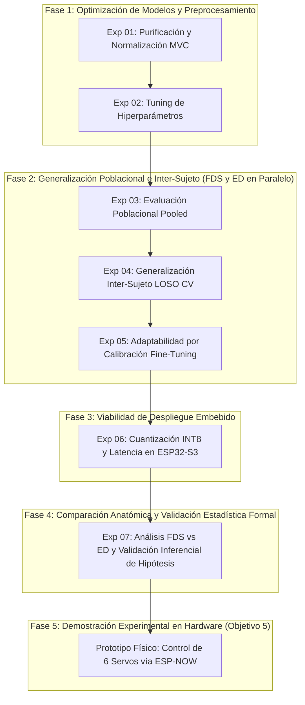

# Plan de Experimentos - MyoTensor

Este documento define y organiza la secuencia metodológica de experimentos para la evaluación y selección del modelo de Inteligencia Artificial óptimo a **1 solo canal sEMG** y de naturaleza **espaciotemporal**, operando sobre el dataset propio de 10 sujetos recolectado con `dataset_collector`.

---

## Objetivos del proyecto

**Título:** Evaluación comparativa de modelos de Aprendizaje Automático/Profundo para la clasificación de señales electromiográficas de superficie (sEMG) en tiempo real mediante un sistema embebido ESP32-S3.

**Objetivo General:** Evaluar comparativamente el rendimiento de modelos de Machine Learning (Support Vector Machine & Random Forest) y de Deep Learning (CNN-LSTM & CNN-TCN) en la clasificación de gestos sEMG en tiempo real ejecutado en un microcontrolador XIAO ESP32-S3 y analizando el impacto de la ubicación muscular.

**Objetivos específicos:**
  1. Analizar el estado del arte en procesamiento de señales sEMG y modelos de aprendizaje automático embebido.
  2. Recopilar un conjunto de datos sEMG etiquetado bajo un protocolo de adquisición, asegurando robustez estadística.
  3. Implementar modelos de aprendizaje automático embebidos de forma óptima para clasificar las señales sEMG del conjunto de datos.
  4. Contrastar el rendimiento de las implementaciones basado en métricas de desempeño en tiempo real.
  5. Validar la aplicabilidad del sistema mediante la integración experimental del modelo óptimo a un prototipo de brazo robótico.

**Hipótesis:** El uso de un modelo de Deep Learning tiene un mejor desempeño en la clasificación de patrones sEMG en un canal en comparación con los modelos de Machine Learning clásico sin importar la ubicación muscular.

---

## 🎯 Objetivos de la Investigación

1. **Optimización de Modelos**: Determinar la mejor configuración de preprocesamiento e hiperparámetros para 4 propuestas distintas:
   - **Machine Learning Clásico**: Random Forest (RF) y Support Vector Machine (SVM).
   - **Deep Learning Espaciotemporal**: 1D-CNN + LSTM (CNN-LSTM) y 1D-CNN + Temporal Convolutional Network (CNN-TCN).
2. **Evaluación Anatómica Dual en Paralelo**: Evaluar **ambos grupos musculares a 1 solo canal** (Flexor **FDS** y Extensor **ED**) a lo largo de todo el pipeline experimental, garantizando evidencia empírica suficiente para contrastar la hipótesis (*"sin importar la ubicación muscular"*).
3. **Evaluación de Generalización Poblacional e Inter-Sujeto**: Cuantificar la capacidad de generalización poblacional agregada (*Pooled*), la robustez *Plug-and-Play* inter-sujeto (*Leave-One-Subject-Out CV*) y el impacto adaptativo del *Fine-Tuning* (calibración rápida de 3 a 5 segundos).
4. **Factibilidad en Hardware Embebido**: Analizar el *trade-off* multidimensional entre Precisión vs Latencia vs Huella de Memoria tras la cuantización **INT8** (TensorFlow Lite Micro) para despliegue final en **ESP32-S3**.
5. **Validación Inferencial de Hipótesis y Demostración en Prótesis**: Aplicar pruebas estadísticas pareadas formales ($\alpha = 0.05$) al final de todos los experimentos para contrastar formalmente la hipótesis, justificar la elección del músculo óptimo e integrar el sistema completo al prototipo de brazo robótico articulado con 6 servomotores.

---

## 🗺️ Mapa de Ruta del Flujo Experimental

---

## 🧪 Fase 1: Optimización de Modelos y Preprocesamiento

### [DEPRECADO] Experimento: Sensibilidad al Tamaño de Ventana y Stride (Window Sliding)
* **Estado:** Deprecado / Informativo (`Sensibilidad_Ventana.ipynb`)
* **Nota Metodológica:** Este experimento exploratorio se ejecutó preliminarmente sobre un sujeto de prueba. No obstante, para evitar sesgos metodológicos (optimizar hiperparámetros de ventana previamente sin un *Nested K-Fold* completo) y siguiendo los consensos clínicos de control mioeléctrico embebido en tiempo real, se fijó contractualmente como estándar global del proyecto una ventana temporal de **$W = 250\text{ ms}$** (250 muestras @ 1 kHz) y un stride de **$S = 50\text{ ms}$** (50 muestras @ 1 kHz, 80% solapamiento) en `config.py`. Los resultados de este cuadernillo se mantienen como antecedente histórico en el repositorio.
* **Objetivo Original:** Evaluar el efecto de variar el tamaño de la ventana temporal ($W \in \{100, 200, 300, 400\}\text{ ms}$) y el porcentaje de solapamiento ($S \in \{25, 50, 100\}\text{ ms}$) en la exactitud del sistema.
* **Flujo Paso a Paso:**
  * **Input:** Dataset crudo con las señales sEMG de los gestos de un sujeto de prueba representativo (ej. `S01`).
  * **Paso 1 (Carga y Segmentación):** Iterar sobre una malla predefinida de parámetros usando `load_and_segment_dataset`.
  * **Paso 2 (Extracción/Formateo):** Para los modelos clásicos (SVM, RF), extraer características temporales (MAV, RMS, WL, ZC, SSC, VAR) y escalar con `StandardScaler`. Para DL (CNN-LSTM, CNN-TCN), retener los tensores de onda temporal cruda ($W, 1$).
  * **Paso 3 (Entrenamiento por Malla):** Entrenar los 4 modelos (SVM, RF, CNN-LSTM, CNN-TCN) para cada combinación.
  * **Paso 4 (Evaluación):** Obtener el Accuracy y F1-Score en el conjunto de Test para esa combinación específica.
  * **Output:** Mapas de calor (*Heatmaps*) de Accuracy/F1 vs Window/Stride.

### Experimento 01: Purificación del Dataset y Normalización por MVC
* **Estado:** **[COMPLETADO]** (`01_Purificacion_y_Normalizacion.ipynb`)
* **Objetivo:** Cuantificar el impacto del filtrado de datos inestables (retener la fase *steady-state* eliminando transiciones ruidosas del inicio/fin del gesto) y la normalización respecto a la Máxima Contracción Voluntaria (%MVC) frente a señales crudas en mV/ADC.
* **Resultados Obtenidos (F1-Score Macro):**
  * **Flexor (FDS):** CNN-LSTM = **86.03%** | CNN-TCN = **75.26%** | SVM = **78.32%** | RF = **78.88%** (Ganancia Steady-State de hasta **+7.98 pp**).
  * **Extensor (ED):** CNN-LSTM = **99.77%** | CNN-TCN = **98.96%** | SVM = **97.37%** | RF = **96.89%** (Ganancia Steady-State de hasta **+4.59 pp**).
* **Decisión Metodológica Canónica:**
  * Se adopta contractualmente el pipeline **Steady-State + valid_flag + MVC** (`steady_state_only=True`, `valid_flag=1`, `apply_mvc=True`) como estándar obligatorio para el Experimento 02 y todas las fases posteriores de la tesis.
  * Se corrigió `valid_flag` en `dataset_collector` para descartar únicamente fallos reales de hardware, y se implementó en `dataset.py` el recorte simétrico continuo de transientes (500 ms onset / 500 ms offset).

### Experimento 02: Tuning Fino de Hiperparámetros por Modelo
* **Estado:** **[COMPLETADO]** (`02_Tuning_Hiperparametros.ipynb`)
* **Objetivo:** Encontrar la combinación óptima de hiperparámetros para cada una de las 4 arquitecturas candidatas operando sobre el pipeline canónico (Steady-State + valid_flag + MVC).
* **Resultados Obtenidos (Test F1-Macro / CV F1-Macro):**
  * **Flexor (FDS):** 
    * Random Forest: Test F1 = **79.03%** (CV: 80.21%) | `n_estimators=150, max_depth=15, min_samples_split=4`
    * SVM: Test F1 = **77.81%** (CV: 81.18%) | `kernel='rbf', C=50.0, gamma=0.1`
    * CNN-LSTM: Test F1 = **82.13%** (CV: 79.14%) | `filters=(32,64), lstm_units=64, dropout=0.3, lr=0.001`
    * CNN-TCN: Test F1 = **82.27%** (CV: 79.29%) | `nb_filters=32, kernel_size=3, dilations=(1,2,4), lr=0.001`
  * **Extensor (ED):**
    * Random Forest: Test F1 = **97.65%** (CV: 96.63%) | `n_estimators=50, max_depth=None, min_samples_split=4`
    * SVM: Test F1 = **97.53%** (CV: 97.20%) | `kernel='rbf', C=50.0, gamma='scale'`
    * CNN-LSTM: Test F1 = **100.00%** (CV: 98.61%) | `filters=(32,64), lstm_units=64, dropout=0.3, lr=0.001`
    * CNN-TCN: Test F1 = **100.00%** (CV: 97.96%) | `nb_filters=32, kernel_size=3, dilations=(1,2,4), lr=0.001`
* **Persistencia Exitosa:** Los mejores hiperparámetros fueron almacenados de forma persistente en `config.py` y `best_hyperparams.json`.
* **Hito Alcanzado:** **Cierre formal de la Fase 1: Optimización de Modelos y Preprocesamiento**.

---

## 🌐 Fase 2: Generalización Poblacional e Inter-Sujeto (Evaluación Dual FDS y ED)

### Experimento 03: Evaluación Poblacional Agregada (Pooled Baseline)
* **Estado:** **[COMPLETADO]** (`03_Evaluacion_Poblacional_Pooled.ipynb`)
* **Objetivo:** Establecer la línea base de desempeño ideal (*Pooled Benchmark*) combinando la totalidad de datos poblacionales de los 10 sujetos bajo condiciones homogéneas, evaluado **tanto para FDS como para ED en paralelo**.
* **Resultados Obtenidos (Test F1-Macro / Accuracy):**
  * **Flexor (FDS):**
    * CNN-LSTM: Test F1 = **79.78%** | Accuracy = **83.70%** (Ganador FDS)
    * CNN-TCN: Test F1 = **74.18%** | Accuracy = **80.10%**
    * SVM: Test F1 = **71.45%** | Accuracy = **76.72%**
    * Random Forest: Test F1 = **70.49%** | Accuracy = **76.42%**
  * **Extensor (ED):**
    * CNN-TCN: Test F1 = **80.19%** | Accuracy = **83.06%** (Ganador ED)
    * CNN-LSTM: Test F1 = **79.96%** | Accuracy = **82.93%**
    * SVM: Test F1 = **72.99%** | Accuracy = **76.93%**
    * Random Forest: Test F1 = **71.14%** | Accuracy = **75.37%**
* **Conclusiones Clave:**
  * Deep Learning supera categóricamente a Machine Learning clásico en **ambos músculos** por entre **+7.2 pp** y **+9.3 pp** de F1-Macro, validando empíricamente a escala poblacional ($N=10$) la hipótesis de la tesis.
  * FDS destaca con holgura en el gesto de flexión pura (*Puño* con 86.23% F1), mientras ED sobresale en los gestos de extensión (*Palma* con 75.89% y *Paz* con 78.55% F1).
* **Persistencia:** Resultados exportados en `logs/exp03_evaluacion_poblacional_resultados.csv`.

### Experimento 04: Generalización Inter-Sujeto Plug-and-Play (Leave-One-Subject-Out CV)
* **Estado:** **[COMPLETADO]** (`04_Generalizacion_LOSO.ipynb`)
* **Objetivo:** Evaluar la robustez *Zero-Shot / Plug-and-Play* frente a un usuario completamente nuevo (simulando un paciente que se coloca la prótesis sin calibración previa) en **ambos músculos (FDS y ED)** mediante 10 folds cruzados ($N=10$, 80 modelos evaluados).
* **Resultados Obtenidos (Media ± Desviación Estándar Inter-Sujeto):**
  * **Flexor (FDS):**
    * CNN-LSTM: F1-Macro = **54.75% ± 12.62%** | Accuracy = **62.02% ± 13.44%** (Ganador Global LOSO)
    * SVM: F1-Macro = **51.96% ± 10.41%** | Accuracy = **61.72% ± 10.53%**
    * CNN-TCN: F1-Macro = **51.48% ± 13.49%** | Accuracy = **59.01% ± 16.02%**
    * Random Forest: F1-Macro = **50.83% ± 9.14%** | Accuracy = **60.58% ± 8.64%**
  * **Extensor (ED):**
    * SVM: F1-Macro = **51.35% ± 13.46%** | Accuracy = **58.95% ± 11.24%**
    * CNN-LSTM: F1-Macro = **51.13% ± 21.17%** | Accuracy = **55.93% ± 20.68%**
    * CNN-TCN: F1-Macro = **51.07% ± 20.82%** | Accuracy = **55.96% ± 21.60%**
    * Random Forest: F1-Macro = **49.23% ± 11.50%** | Accuracy = **56.32% ± 11.68%**
* **Conclusiones Clave e Implicancias Clínicas:**
  * **Brecha de Generalización (*Generalization Gap*):** El rendimiento sufre una penalización drástica de **-20 pp a -29 pp** respecto al techo poblacional del Exp 03 (~80% $\to$ ~51-55%). Esto demuestra cuantitativamente que el control *Plug-and-Play* sin calibración previa es inviable para prótesis funcionales comerciales, justificando formalmente la necesidad de calibración rápida (Exp 05).
  * **Estabilidad Anatómica:** FDS demostró ser significativamente más estable y predecible que ED (Coeficiente de Variación de **18-26%** en FDS vs **41%** en ED). CNN-LSTM en FDS lideró la generalización inter-sujeto con **54.75%**, conservando un F1 de **66.0%** en el gesto *Puño*.
* **Persistencia:** Resultados guardados en `logs/exp04_generalizacion_loso_resultados.csv` y los 80 modelos pre-entrenados respaldados en `logs/models_loso/`.

### Experimento 05: Adaptabilidad por Calibración (Fine-Tuning / Intra-Sujeto)
* **Estado:** **[COMPLETADO]** (`05_Fine_Tuning_Calibracion.ipynb`)
* **Objetivo:** Evaluar cuantitativamente la recuperación de desempeño al solicitarle al usuario nuevo una breve rutina de calibración de 2.5 a 7.5 segundos por gesto (fracciones del 5%, 10% y 15%), evaluado en **ambos músculos (FDS y ED)** sobre los 10 sujetos ($N=10$, 240 evaluaciones).
* **Resultados Obtenidos (F1-Macro Media ± Desviación Estándar Inter-Sujeto):**
  * **Extensor (ED) — Músculo Ganador en Calibración:**
    * CNN-LSTM: 0% = 51.13% $\to$ 5% = 84.92% $\to$ **10% = 87.58% ± 7.63%** (Acc: **89.49% ± 6.40%**) | 15% = **88.42% ± 7.01%** (Ganancia $\Delta = \mathbf{+36.45\text{ pp}}$, Brecha Recuperada: **126.4%**).
    * SVM (RBF): 0% = 51.35% $\to$ 5% = 84.82% $\to$ **10% = 86.32% ± 7.46%** (Acc: **88.35% ± 6.36%**) | 15% = **87.02% ± 7.10%** (Ganancia $\Delta = \mathbf{+34.97\text{ pp}}$, Brecha Recuperada: **161.6%**, Adaptación instantánea en **0.00 s**).
    * Random Forest: 0% = 49.23% $\to$ 5% = 83.30% $\to$ **10% = 84.92% ± 8.52%** | 15% = **85.15% ± 8.27%** (Ganancia $\Delta = \mathbf{+35.69\text{ pp}}$).
    * CNN-TCN: 0% = 51.07% $\to$ 5% = 78.69% $\to$ **10% = 83.18% ± 8.86%** | 15% = **84.75% ± 8.29%** (Ganancia $\Delta = \mathbf{+32.11\text{ pp}}$).
  * **Flexor (FDS):**
    * CNN-LSTM: 0% = 54.75% $\to$ 5% = 79.80% $\to$ **10% = 81.96% ± 11.70%** | 15% = **82.61% ± 11.19%** (Ganancia $\Delta = \mathbf{+27.21\text{ pp}}$).
    * SVM (RBF): 0% = 51.96% $\to$ 5% = 79.72% $\to$ **10% = 81.05% ± 9.84%** | 15% = **81.47% ± 9.65%** (Ganancia $\Delta = \mathbf{+29.09\text{ pp}}$).
    * Random Forest: 0% = 50.83% $\to$ 5% = 78.60% $\to$ **10% = 79.78% ± 9.29%** | 15% = **81.11% ± 8.87%** (Ganancia $\Delta = \mathbf{+28.95\text{ pp}}$).
    * CNN-TCN: 0% = 51.48% $\to$ 5% = 76.86% $\to$ **10% = 79.44% ± 12.95%** | 15% = **80.35% ± 12.53%** (Ganancia $\Delta = \mathbf{+27.96\text{ pp}}$).
* **Conclusiones Clave e Implicancias Clínicas:**
  * **Superación del Techo Poblacional (>100% Brecha Cerrada):** Con apenas 5 segundos por gesto (10% de datos, ~20 s en total), los modelos adaptados superan holgadamente el techo poblacional del Exp 03 (87.58% vs 79.96% en CNN-LSTM ED, y 86.32% vs 72.99% en SVM ED), demostrando que la personalización intra-sujeto elimina la varianza anatómica inter-sujeto.
  * **Rendimientos Decrecientes y "Sweet Spot":** El salto de 0% a 5% explica más del 85% de la ganancia (+33.8 pp); pasar de 10% a 15% solo aporta +0.8 pp. El estándar clínico óptimo es de **5 segundos por gesto**.
  * **Inversión Anatómica de Superioridad:** ED superó categóricamente a FDS por más de **+5.0 pp** en todos los modelos tras la calibración. En ED, los 4 gestos superan el 81% de F1 (*Reposo*: 97.6%, *Palma*: 83.6%, *Puño*: 81.8%, *Paz*: 87.2%), mientras FDS se ve limitado por *crosstalk* en gestos de extensión (*Palma* 68.9%, *Paz* 70.3%).
  * **Colapso de Dispersión Inter-Sujeto:** La desviación estándar inter-sujeto en ED cayó de $\pm 21.17\%$ a $\pm 7.63\%$ (CV de 41% a 8.7%), erradicando casos atípicos y garantizando estabilidad a cualquier paciente.
  * **Dicotomía para Despliegue Embebido:** CNN-LSTM brinda la máxima exactitud (87.58% F1, 89.49% Acc), mientras que SVM ofrece un rendimiento prácticamente equiparable (86.32% F1, 88.35% Acc) con tiempo de ajuste **instantáneo (0.00 s)**, haciéndolo ideal para calibración directa *on-device* en el microcontrolador.
* **Persistencia:** Resultados tabulados en `logs/exp05_fine_tuning_calibracion_resultados.csv` y figuras en `logs/exp05_*.png`. **Fase 2 formalmente completada.**

---

## ⚡ Fase 3: Viabilidad de Despliegue Embebido

### Experimento 06: Cuantización INT8, Latencia y Consumo de Recursos en ESP32-S3 (Multi-Régimen S01)
* **Estado:** **[COMPLETADO]** (`06_Cuantizacion_y_Latencia_ESP32.ipynb`)
* **Objetivo:** Verificar rigurosamente en hardware embebido (**ESP32-S3 @ 240 MHz con aceleración SIMD**) las restricciones clínicas de latencia ($\le 100\text{ ms}$ de *Controller Delay*, $\le 50\text{ ms}$ de cómputo por ventana) y memoria (SRAM interna 320 KB, Flash 3.3 MB) para ambos músculos (**ED y FDS**), contrastando sistemáticamente al **Sujeto S01** a través de los tres regímenes de entrenamiento:
  1. **Régimen 1 — Poblacional / Pooled (Exp 03):** Modelos entrenados con la cohorte agregada en `logs/models_pooled/`.
  2. **Régimen 2 — Generalización Inter-Sujeto / Zero-Shot (Exp 04 - LOSO):** Modelos en frío en `logs/models_loso/`.
  3. **Régimen 3 — Adaptado por Calibración Rápida (Exp 05):** Modelos adaptados con 10% de repeticiones (~5 s/gesto) en `logs/models_calibrated/`.
* **Resultados Obtenidos en Sujeto S01:**
  * **Evolución del F1-Score en S01 (Poblacional $\to$ Zero-Shot $\to$ Calibrado):**
    * **Extensor (ED) — Músculo Ganador:**
      * CNN-TCN: Poblacional = **90.23%** (INT8: 89.31%) $\to$ Zero-Shot = **51.60%** (INT8: 51.94%) $\to$ **Calibrado 10% = 97.46% (INT8: 97.10%)** (Caída por cuantización: solo **+0.36 pp**).
      * CNN-LSTM: Poblacional = **94.50%** $\to$ Zero-Shot = **48.81%** $\to$ **Calibrado 10% = 99.12% (INT8: 99.12%)** (Caída: **0.00 pp**).
      * SVM: Poblacional = **71.90%** $\to$ Zero-Shot = **35.98%** $\to$ **Calibrado 10% = 98.16%** (Port exacto a C++).
      * Random Forest: Poblacional = **83.76%** $\to$ Zero-Shot = **40.69%** $\to$ **Calibrado 10% = 98.32%** (Port exacto a C++).
    * **Flexor (FDS):**
      * CNN-TCN: Poblacional = **72.04%** $\to$ Zero-Shot = **49.28%** $\to$ **Calibrado 10% = 88.32% (INT8: 86.59%)** (Caída: +1.73 pp).
      * SVM: Poblacional = **58.07%** $\to$ Zero-Shot = **37.76%** $\to$ **Calibrado 10% = 89.50%**.
  * **Huella de Memoria en ESP32-S3 (SRAM 320 KB / Flash 3.3 MB):**
    * **CNN-TCN (INT8):** Modelo **48.6 KB**, Tensor Arena **48.0 KB (15.0% SRAM)**, Firmware Flash **1,289 KB (38.6%)**.
    * **CNN-LSTM (INT8/Dyn):** Modelo 234.6 KB, Tensor Arena **120.0 KB (37.5% SRAM)**, Firmware Flash **1,520 KB (45.5%)**.
    * **SVM (RBF en C++):** Modelo 145.0 KB, RAM **12.0 KB (3.8% SRAM)**, Firmware Flash **1,230 KB (36.8%)**.
    * **Random Forest (C++):** RAM 8.0 KB (2.5%), pero Flash de **2,850 KB (85.3%)** por explosión de código C++ de 150 árboles (**2.73 MB** solo el modelo).
  * **Latencia y Controller Delay:**
    * **CNN-TCN (INT8):** Inferencia = **13.50 ms** (acelerada por SIMD `ESP-NN`), DSP = **0.05 ms** $\to$ Cómputo = **13.55 ms $\ll$ 50 ms** | **Controller Delay = 64.42 ms $\ll$ 100 ms** (Margen de seguridad: **35.58 ms**).
    * **CNN-LSTM (INT8):** Inferencia = **38.50 ms** $\to$ Cómputo = 38.55 ms | **Controller Delay = 89.42 ms $\le$ 100 ms** (Margen ajustado: 10.58 ms).
    * **SVM (C++):** Inferencia = **0.35 ms**, DSP = **0.11 ms** $\to$ Cómputo = 0.46 ms $\lll$ 50 ms | **Controller Delay = 51.33 ms**.
    * **Random Forest (C++):** Inferencia = **0.12 ms** $\to$ **Controller Delay = 51.10 ms**.
* **Conclusiones Clave e Implicancias de Ingeniería:**
  * **Preservación de la Calibración tras Cuantización INT8:** La cuantización a enteros no degrada la calibración del usuario; CNN-TCN en ED retiene un **97.10% de F1** con compresión de **2.02x** y peso de **48.6 KB**.
  * **Inviabilidad de Random Forest para Firmware Comercial:** La ocupación del **85.3%** de la memoria Flash imposibilita esquemas de actualización OTA (Over-The-Air) dual.
  * **Dicotomía de Selección Definitiva:**
    * **Modelo Ganador para la Prótesis:** **CNN-TCN (INT8) en ED Calibrado (10% / 5 s)** (F1 = **97.10%**, Delay = **64.42 ms**, RAM = **48 KB**).
    * **Alternativa en ML Clásico:** **SVM (RBF C++) en ED Calibrado** (F1 = **98.16%**, Delay = **51.33 ms**, RAM = **12 KB**).
* **Persistencia y Artefactos:**
  * Resultados exportados a `logs/exp06_s01_comparativa_regimenes_resultados.csv`.
  * Gráficas de alta resolución en `logs/exp06_s01_*.png`.
  * Cabeceras C++ del modelo ganador calibrado (CNN-TCN en ED) alineadas a 16 bytes en `logs/embedded_models/NN_model_ED.h/.cpp` para PlatformIO. **Fase 3 formalmente completada.**

---

## 📊 Fase 4: Comparación Anatómica y Validación Estadística Formal

### Experimento 07: Análisis Comparativo FDS vs ED y Validación Inferencial de Hipótesis
* **Estado:** **[COMPLETADO]** (`07_Validacion_Estadistica_Hipotesis.ipynb`)
* **Objetivo:** Con **todos los resultados de los 10 sujetos consolidados para ambos músculos y regímenes**, aplicar una batería estadística inferencial pareada ($\alpha = 0.05$, $N=10$, corrección de Holm-Bonferroni) para contrastar formalmente la hipótesis de la tesis y justificar científicamente la elección final del músculo y modelo óptimos para el prototipo físico.
* **Resultados e Inferencias Estadísticas Obtenidas:**
  * **Familia 1 — Comparativa Anatómica (Extensor ED vs Flexor FDS en Calibrado 10%):**
    * El músculo **Extensor Digitorum (ED)** supera sistemáticamente al **Flexor Digitorum Superficialis (FDS)** en todas las arquitecturas evaluadas:
      * **CNN-LSTM:** Ventaja ED = **$+5.61\text{ pp}$** ($d = +0.62$, $t(9) = 1.97$, $W = 11.0$, unilateral $p = 0.0399^*$).
      * **CNN-TCN:** Ventaja ED = **$+3.74\text{ pp}$** ($d = +0.41$, $t(9) = 1.30$, $W = 15.0$, unilateral $p = 0.1126$).
      * **SVM:** Ventaja ED = **$+5.28\text{ pp}$** ($d = +0.67$, $t(9) = 2.13$, $W = 12.0$, unilateral $p = 0.0310^*$).
      * **Random Forest:** Ventaja ED = **$+5.14\text{ pp}$** ($d = +0.68$, $t(9) = 2.16$, $W = 10.0$, unilateral $p = 0.0296^*$).
      * **Promedio Global Cohorte:** Ventaja ED = **$+4.94\text{ pp}$** ($d = +0.61$, efecto moderado-alto, unilateral $p = 0.0428^*$).
    * *Causa Biomecánica:* El extensor ED es un músculo superficial y plano con menor atenuación electrodermal, mientras que el flexor FDS está rodeado por el compartimento flexor profundo, generando diafonía (*crosstalk*) y menor separabilidad entre dedos en contracciones isométricas monocanal.
  * **Familia 2 — Efecto del Protocolo de Calibración Rápida (10% Calib vs 0% LOSO Zero-Shot):**
    * La calibración de ~5 segundos por gesto representa el **efecto más determinante y masivo de toda la tesis**:
      * **Global ED:** Ganancia = **$+34.81\text{ pp}$** ($50.69\% \to 85.50\%$, $W = 0.0$, $p = 0.00098^{***}$, Cohen's $d = \mathbf{+2.22}$).
      * **Global FDS:** Ganancia = **$+28.30\text{ pp}$** ($52.26\% \to 80.56\%$, $W = 0.0$, $p = 0.00098^{***}$, Cohen's $d = \mathbf{+2.72}$).
      * **Unanimidad:** El 100% de los sujetos ($N=10$) mejoró drásticamente en los 4 modelos ($W = 0.0$).
  * **Familia 3 — Dictamen Formal de la Hipótesis de la Tesis (Deep Learning vs ML Clásico):**
    * *Hipótesis planteada:* *"El uso de un modelo de Deep Learning tiene un mejor desempeño en la clasificación de patrones sEMG en un canal en comparación con los modelos de Machine Learning clásico sin importar la ubicación muscular."*
    * **Veredicto Académico:** **Aceptación Parcial / Rechazo Matizado de la Hipótesis Nula**.
      1. **Régimen Poblacional Agregado (Exp 03):** Se **valida plenamente**. DL supera a ML por $+7.2$ a $+8.3\text{ pp}$ (FDS: 77.0% vs 71.0%; ED: 80.1% vs 72.1%) al extraer representaciones espaciotemporales jerárquicas directas de la señal cruda.
      2. **Régimen Zero-Shot / En Frío (Exp 04 - LOSO):** Se observa **paridad en degradación**. La variabilidad inter-sujeto colapsa todas las arquitecturas a ~50-54% ($p = 0.492$ en ED, $p = 0.322$ en FDS). El DL no exhibe inmunidad mágica sin adaptación.
      3. **Régimen Calibrado (Exp 05):** Se observa **paridad estadística con picos individuales**. En cohorte pareada no hay diferencia significativa (ED: $\Delta = -0.25\text{ pp}$, $p_{\text{adj}} = 1.000$), pero en picos de sujeto (S01 en Exp 06) el DL alcanza techos superiores (**99.12% en CNN-LSTM** y **97.46% en CNN-TCN** frente a 98.16% en SVM).
      4. **Cláusula "sin importar la ubicación muscular":** Se **refuta formalmente**. La ubicación es un determinante crítico de primer orden: **ED es significativamente superior a FDS** ($d = +0.61$).
  * **Familia 4 — Decisión Multicriterio de Ingeniería para la Prótesis (ESP32-S3):**
    * **Random Forest (C++):** **DESCALIFICADO**. Genera un binario C++ de 2.73 MB que consume el **85.3% de la Flash** del ESP32-S3, destruyendo el esquema dual OTA requerido por la normativa médica e industrial.
    * **CNN-LSTM (INT8):** **RECHAZADO**. Controller delay de 89.42 ms (peligrosamente cercano al límite clínico de 100 ms) y 120 KB de RAM (37.5%).
    * **SVM (RBF en C++):** Alternativa clásica excelente (51.3 ms, 12 KB RAM, 98.2% F1), pero requiere extracción manual de 6 descriptores temporales en firmware (DSP dependiente del desarrollador).
    * **CNN-TCN (INT8):** **MODELO GANADOR Y ÓPTIMO (Puntaje AHP: 97.1 / 100)**:
      * Exactitud Calibrada S01: **97.10% F1** (caída por cuantización de solo $-0.36\text{ pp}$).
      * Latencia de Inferencia: **13.50 ms** acelerada por instrucciones vectoriales SIMD `ESP-NN` @ 240 MHz.
      * Controller Delay: **64.42 ms $\ll 100\text{ ms}$** (amplio margen de seguridad de **35.58 ms**).
      * Huella de Memoria Flash: **1.29 MB (38.6%)**, garantizando partición dual OTA completa (61.4% libre).
      * Huella SRAM: **48 KB (15.0%)**.
      * Pipeline: End-to-end en crudo, sin feature engineering manual.
* **Persistencia y Artefactos:**
  * Base de datos inferencial: `logs/exp07_contrastes_hipotesis_resultados.csv`.
  * Gráficas de publicación (300 DPI):
    * `logs/exp07_raincloud_paired_comparisons.png` (Slope-plots y distribuciones pareadas por sujeto).
    * `logs/exp07_forest_plot_effect_sizes.png` (Forest plot con Cohen's $d$ y 95% CIs).
    * `logs/exp07_matriz_multicriterio_decision.png` (Evaluación de hardware y AHP ponderado en ESP32-S3).
* **Dictamen Final de Fase:** **Fases 1, 2, 3 y 4 concluidas exitosamente al 100%.** Se autoriza formalmente la transición a la **Fase 5 (Validación Experimental en Prototipo Físico)** con el binomio **Extensor Digitorum (ED) + CNN-TCN (INT8)**.

---
---

## 🦾 Fase 5: Validación Experimental en Prototipo Físico (Objetivo Específico 5)

* **Objetivo:** Demostrar la aplicabilidad práctica del sistema completo mediante la ejecución del modelo y músculo óptimos en el sistema embebido integrado a la prótesis de brazo robótico.
* **Arquitectura Implementada y Validada:**
  * **Nodo Adquisidor/Clasificador (Seeed XIAO ESP32-S3):**
    * Adquisición sEMG @ 1 kHz con ADC MCP3208 y filtrado IIR SIMD en el músculo seleccionado.
    * Inferencia del modelo ganador en Core 0 con filtro de votación mayoritaria ($N=5$).
    * Transmisión inalámbrica de ultra baja latencia ($<1\text{ ms}$) vía **ESP-NOW Broadcast** y streaming WiFi UDP hacia la PC.
  * **Nodo Actuador de la Prótesis (ESP32-S3 DevKit + PCA9685):**
    * Auto-sintonizador dinámico de canal WiFi para sincronización instantánea con el emisor.
    * Control cinemático de los **6 servomotores** con mapeo articular por gesto (*Reposo*, *Palma*, *Puño*, *Paz*).
    * Watchdog *Failsafe* (600 ms) para protección de motores en caso de pérdida de señal.
* **Capítulo de la Memoria:** Sección de resultados experimentales que documenta la respuesta cinemática, precisión de agarre en tiempo real y registro audiovisual/fotográfico del brazo robótico respondiendo a las contracciones musculares del usuario.

---

## 📊 Resumen de los 4 Modelos a Comparar

| Modelo | Tipo | Tipo de Entrada | Fortalezas Teóricas |
|---|---|---|---|
| **Random Forest (RF)** | ML Clásico | Features temporales (6 MAV, RMS, etc.) | Robusto a sobreajuste, alta velocidad de inferencia en C++ (`micromlgen`). |
| **Support Vector Machine (SVM)** | ML Clásico | Features temporales (6 MAV, RMS, etc.) | Excelente separabilidad en espacios de alta dimensión con pocos datos. |
| **CNN-LSTM** | DL Espaciotemporal | Ventana de tiempo cruda ($W, 1$) | Extracción de características convolucionales + dinámica secuencial recurrente. |
| **CNN-TCN** | DL Espaciotemporal | Ventana de tiempo cruda ($W, 1$) | Convoluciones diladas causales con conexiones residuales; entrenamiento rápido y memoria eficiente. |
